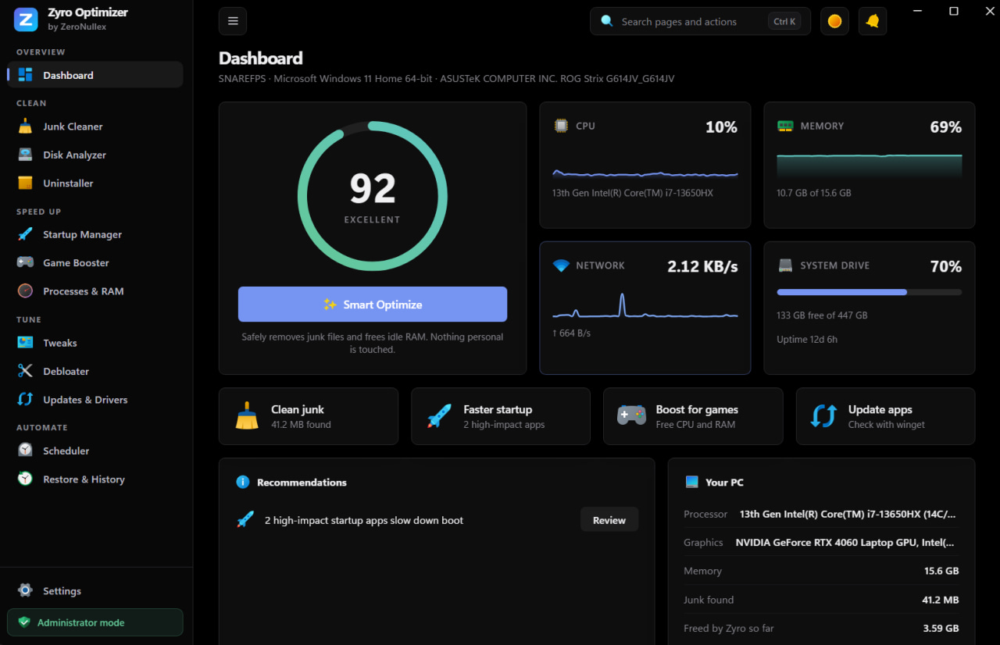
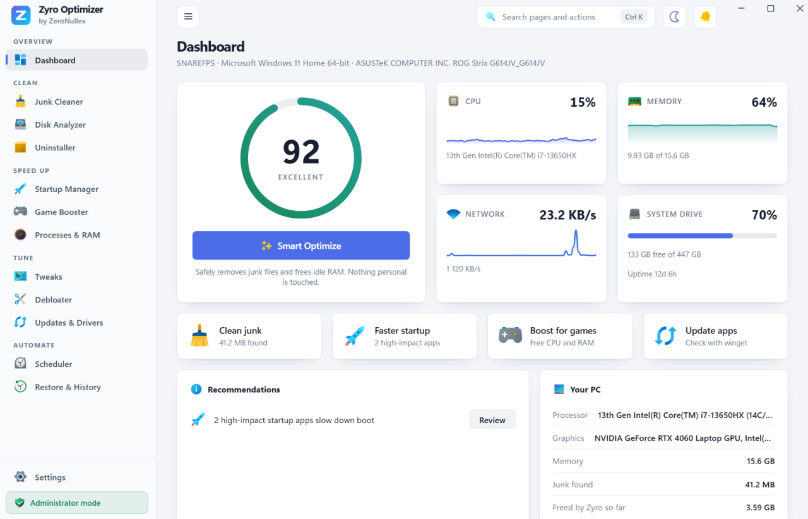

<p align="center">
  
</p>

<h1 align="center">Zyro Optimizer</h1>

<p align="center">
  A fast, safe and reversible PC optimizer for Windows 10 and 11.<br>
  Clean junk, trim startup, tune settings, and undo any of it.
</p>

<p align="center">
  <a href="https://github.com/snarefps/Zyro-Optimizer/releases/latest"></a>
  <a href="LICENSE"></a>
  
  
  <a href="https://t.me/ZeroNullex"></a>
</p>

<p align="center">
  
  
</p>

## Download

| File | Platform | Version |
| --- | --- | --- |
| **[Zyro-Optimizer-x64-setup.exe](https://github.com/snarefps/Zyro-Optimizer/releases/latest/download/Zyro-Optimizer-x64-setup.exe)** | Windows 10 / 11, 64-bit | Latest |

Older versions, release notes and SHA-256 checksums are on the [Releases page](https://github.com/snarefps/Zyro-Optimizer/releases).

> [!NOTE]
> The installer installs for your user only, so it needs no admin rights. It is not code-signed yet, so SmartScreen may warn you on first run. Choose **More info**, then **Run anyway**.

## Why Zyro

- **Light.** The installer is under 2 MB. With the window open it uses around 90-100 MB, and it drops to a few MB in the tray when you close the window.
- **Reversible.** Registry values, service start types and power plans are saved before a change, so undo restores them exactly.
- **Private.** No account, no ads, no telemetry. Nothing is sent anywhere.
- **Careful.** Protected folders and critical processes are never touched, and a Windows restore point is created before Tune actions.

## Features

| Area | What you get |
| --- | --- |
| **Clean** | Junk cleaner (temp files, update cache, prefetch, thumbnails, crash dumps, Recycle Bin, browser caches), disk analyzer with space map, large-file and duplicate finder, uninstaller with leftover scan |
| **Speed up** | Startup manager (entries, services, scheduled tasks), game booster that restores everything when you stop, process list with RAM trimmer |
| **Tune** | 24 reversible tweaks (privacy, performance, gaming, network, Windows 11), debloater for preinstalled apps, app updates through winget, driver age check |
| **Automate** | Scheduled cleaning from the tray, history page with one-click undo |
| **Interface** | Action Center with live progress for every job, Ctrl+K command palette, dark (true black), light and system themes |

## Safety

> [!IMPORTANT]
> Zyro changes system settings. Everything it changes is logged and can be undone from the History page, but read what you tick before you apply it.

- Automatic deletes go through a protected-path list (Windows, Program Files, Documents, Desktop and so on).
- Files you pick by hand go to the Recycle Bin.
- A Windows restore point is created before Tune actions. It needs admin rights and System Protection, and you can turn it off in Settings.
- The interface talks to the backend through one command that dispatches to a fixed list of functions.

> [!TIP]
> Some items (Windows temp, prefetch, services, system-wide tweaks, restore points) need administrator rights. The app starts without them and marks those items. Use **Restart as admin** in the sidebar to unlock them.

## Build from source

You need Node 20+, Rust (MSVC toolchain) and the WebView2 runtime.

```bash
npm install
npx tauri build
```

The installer ends up in `src-tauri/target/release/bundle/nsis/`. To build it and file it as `Zyro-Optimizer-x64-setup.exe` under a version folder (`../release/v<version>/`, with its checksum and release notes), run `npm run release`.

Run the tests (some touch the real registry under a throwaway key, services and PowerShell, so use a Windows machine):

```bash
cd src-tauri
cargo test
```

## Project layout

```
src/renderer/      React UI: pages, components, helpers
src/shared/        types shared with the backend responses
src-tauri/src/     Rust backend, one file per feature
src-tauri/icons/   app icons
scripts/           release script
docs/              README images
```

## License

The code is under the [Apache License 2.0](LICENSE). You can use, modify and distribute it, including commercially, as long as you follow the license.

If you fork it:

- Keep the [NOTICE](NOTICE) file and the copyright lines, and say in your README that your project is based on Zyro Optimizer by ZeroNullex Team.
- Use your own name and your own logo. "Zyro Optimizer", "ZeroNullex" and the app icon and logo are not licensed. See [TRADEMARKS.md](TRADEMARKS.md).

The interface icons are from [Icons8](https://icons8.com) (Fluency) and keep their own license.

## Community

News and support: [t.me/ZeroNullex](https://t.me/ZeroNullex)

Made with ❤️ by the ZeroNullex Team.
